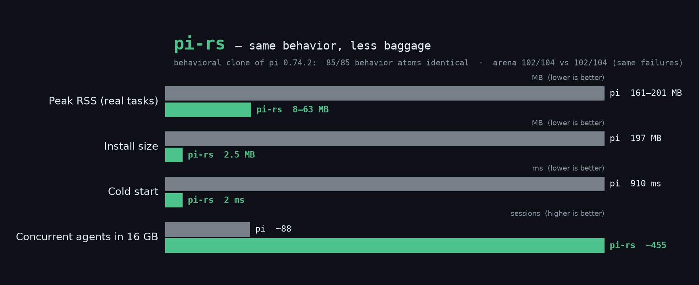

# pi-rs

English ｜ [简体中文](README.zh-CN.md)

[](https://github.com/123123213weqw/pi-rs/actions/workflows/ci.yml)
[](LICENSE)


> A behavioral clone of the [pi](https://github.com/earendil-works/pi) coding agent, rebuilt in Rust.
> Not a rewrite with creative liberties — **169/169 behavior atoms verified identical against pi v1.4.0**, scenario by scenario.



| | pi 0.74.2 (Node ≥ 22.19) | **pi-rs** |
|---|---|---|
| Install size | 197 MB (node_modules) | **2.5 MB single static binary** |
| Peak RSS (real tasks) | 161–201 MB | **8–63 MB (~13–21× lower)** |
| Cold start | 910 ms | **2 ms (~455×)** |
| Runtime deps | Node.js | **none** |
| Arena¹ | 102/104 (98.1%) | **102/104 — same task, same failure** |

¹ harness-arena: 52 tasks × 2 rounds, same model (deepseek-chat), same machine. Full data in [docs/bench.md](docs/bench.md).

An agent spends 99% of its wall time waiting on the model — a different language can't buy speed.
What it *can* buy is density and form factor: **~100 concurrent agent sessions in under 1 GB**, one
file to deploy, nothing to install. That's what pi-rs is for.

## Why a clone, not a fork

Every claim above is reproducible. pi-rs is verified against real pi at three levels:

1. **Behavior atoms (169/169 identical).** Both binaries run against the same scripted mock LLM; every
   request each one sends is recorded and diffed — system prompt (byte-exact), tool schemas, wire
   encoding, request params, stdout, exit codes, session JSONL, filesystem end-state. See
   [tests/atom](tests/atom).
2. **Arena parity.** Registered as a first-class adapter in our private harness-arena benchmark and
   raced against real pi 0.74.2. Score tied at 102/104; the only failing task (`hell-01`) fails in
   *both* arms, the same way.
3. **Occupancy.** `/usr/bin/time -v` peak RSS and wall clock on every arena task. [docs/bench.md](docs/bench.md).

Two documented divergences:
- pi v1.4.0 sends `role: "developer"` only when the catalog flags it; for DeepSeek passthrough models it now sends `system` — pi-rs matches.
- **Identical `oldText` twice in one `edit` call crashes upstream pi** (unhandled exception → auto-retry → the failed attempt is excised from context via `ContextEditEntry`). pi-rs returns the graceful `edits[0] and edits[1] overlap …` error instead — strictly more useful, and the atom suite pins our behavior.

## Quick start

```bash
cargo build --release          # → target/release/pi, one 2.5 MB binary
./target/release/pi "refactor src/foo.rs"               # interactive TUI (initial msg)
./target/release/pi -p "refactor src/foo.rs"            # one-shot print mode
./target/release/pi --mode json -p "list todos"         # JSON event stream
./target/release/pi -t read,grep,find,ls -p "review"    # read-only toolset
DEEPSEEK_API_KEY=sk-... ./target/release/pi -p "hi"
```

Providers: `deepseek` (default), `openai`, or any OpenAI-compatible endpoint via `--api-key` +
catalog ids (`deepseek-chat`, `deepseek-reasoner`, …) or `provider/model` passthrough.

## What's inside

```
┌────────────────────────────────────────────────────────┐
│ pi (CLI)                                               │
│  ├─ args.rs          CLI flags (ported from args.ts)   │
│  ├─ main.rs          print / json / one-shot modes     │
│  ├─ agent.rs         agent loop (toolUse ⇄ toolResult) │
│  ├─ provider.rs      OpenAI-compatible SSE streaming   │
│  ├─ session.rs       session JSONL, header v3, tree    │
│  ├─ system_prompt.rs byte-exact prompt builder         │
│  ├─ context.rs       AGENTS.md / CLAUDE.md discovery   │
│  └─ tools/           the 7 built-in tools              │
└────────────────────────────────────────────────────────┘
```

**The 7 built-in tools**, ported line-for-line from pi 0.74.2 — same names, same JSON schemas,
same truncation (2000 lines / 50 KB), same error strings:

`read` (offset/limit continuation hints) · `bash` (tail truncation, temp-file escape hatch) ·
`edit` (multi-hunk exact replace with NFKC fuzzy fallback, BOM/CRLF aware) · `write` ·
`grep` (ripgrep-backed, `path:line: text`) · `find` (fd-backed, v8-compat) ·
`ls` (case-insensitive sort, `/` suffix). Enabled by default: `read bash edit write`; the
read-only trio activates via `--tools read,grep,find,ls`.

Session files are **drop-in compatible** with pi: same header (`type:"session", version:3`),
same entry tree (8-char ids, parentId chain), same usage accounting
(`input = prompt − cached`), so arena-style bookkeeping reads both harnesses unchanged.

## Implementation notes

- No async runtime: single-threaded event loop + blocking SSE — the agent loop *is* sequential.
- Transcript lives on disk as JSONL; memory holds only what the next request needs.
- Deps kept to five crates: `serde`, `serde_json` (preserve_order — model-emitted key order
  round-trips verbatim), `ureq` (rustls), `uuid`, `unicode-normalization`.
- The edit tool's diff/fuzzy-match engine is a line-for-line port of pi's `edit-diff.ts`,
  including its NFKC smart-quote/dash normalization; `truncate.rs` reproduces pi's
  head/tail truncation bit-for-bit, UTF-8 boundary handling included.

## Reproducing the claims

```bash
# behavior atoms (needs: pi 0.74.2 + pi-rs on one box, no API key)
bash tests/atom/run_atom.sh                     # → 85/85 atoms identical

# occupancy + task parity on a real model
bash tests/parity_v100.sh <tasks-dir> pirs <task-ids>
bash tests/parity_v100.sh <tasks-dir> pi  <task-ids>

# quick end-to-end without any key (scripted mock provider)
bash tests/e2e_mock.sh
```

Numbers, methodology and per-task tables: [docs/bench.md](docs/bench.md).

## Parity scope

**Aligned**: the headless core — agent loop, 7 tools, session format, CLI surface
(`-p`, `--mode json`, `--provider/--model/--api-key/--tools/--thinking/--session-dir/…`),
system prompt, context-file discovery, usage/cost accounting — **and the interactive TUI**:
full-screen transcript (streaming assistant text, inline tool lines, collapsible tool output),
bottom editor with input history, Esc/Ctrl+C abort, `/exit`. Verified end-to-end with
scripted keystrokes in tmux. The v1.4.0 wire is ported too: sectioned system prompt
(`<tools>`/`<rules>`/`<docs>`/`<cwd>`), strict-mode tool schemas, `max_tokens` params,
session `role:"system"` entry with named sections. Gaps vs pi's TUI: autocomplete, model picker, themes,
mouse support, image rendering.

**Roadmap**: extensions & skills loading · MCP client · compaction ·
`--export` HTML · RPC mode · Anthropic-native API. (pi-durable's transactional runtime and
chord plugin host are out of scope for now.)

## Credits & license

pi-rs is a derivative work of [pi](https://github.com/earendil-works/pi) by Mario Zechner
(badlogic / earendil-works) — all design credit belongs to the original. This repo exists to
study a question, not to replace the original: *when the model is the bottleneck, what does the
harness's runtime actually cost you?* If you want the full pi experience — TUI, extensions,
skills — use [pi itself](https://github.com/earendil-works/pi).

MIT. See [LICENSE](LICENSE).
